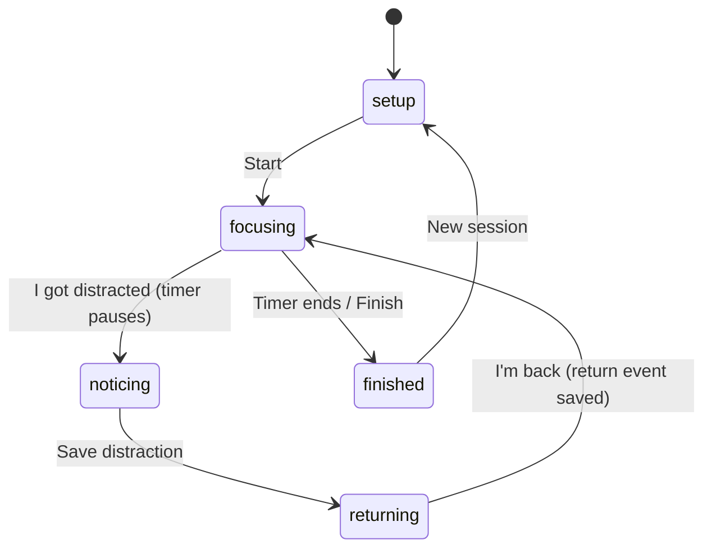

# FocusFlow

Attention-training web app: notice distraction, return to the task, learn your patterns.
(Self-management tool. Not a medical or diagnostic application.)

## Status
- [x] Phase A: Frontend (`frontend/`), data kept in browser localStorage
- [ ] Phase B: Backend (FastAPI + PostgreSQL), then swap `src/services/api.ts` to axios
- [ ] Phase C: Deploy free (Vercel + Render + Neon)

## Run the frontend
```bash
cd frontend
npm install
npm run dev      # open http://localhost:5173
```

## Architecture
```
Page (UI)  ->  hooks / utils  ->  services/api.ts  ->  [localStorage now | FastAPI later]
```
| Layer | Folder | Job |
|---|---|---|
| Pages | `pages/` | One screen per route; compose components |
| Components | `components/` | Reusable UI pieces (common / dashboard / focus) |
| Hooks | `hooks/` | Reusable stateful logic (`useTimer`, `useData`) |
| Services | `services/` | The only code that touches data. Swappable |
| Utils | `utils/` | Pure functions (statistics). Easy to test |
| Types | `types/` | Shared TypeScript shapes, mirror the DB tables |

## Workflow (Focus Room state machine)


## Key design decisions (and why)
1. **Timer uses timestamps, not "minus 1 per tick"**: browsers slow background tabs; timestamps stay accurate.
2. **Service layer with REST-shaped async functions**: the backend swap touches one file.
3. **A distraction pauses the timer**: recording it is practice, not failure (SRS product principle).
4. **Return events live on the distraction** for now; in the DB they become the `return_events` table.
5. **Stats are pure functions** in `utils/stats.ts`: testable without React.
6. Changes vs SRS: axios, Settings and Attention Training pages are postponed; auth arrives with the backend.

## Next steps
Training page (breathing, Notice-Label-Return), Settings, then backend.
